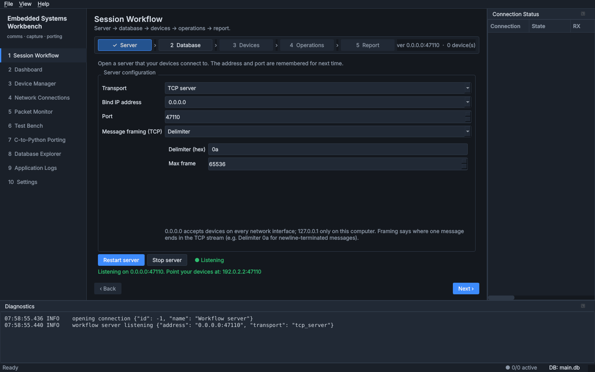
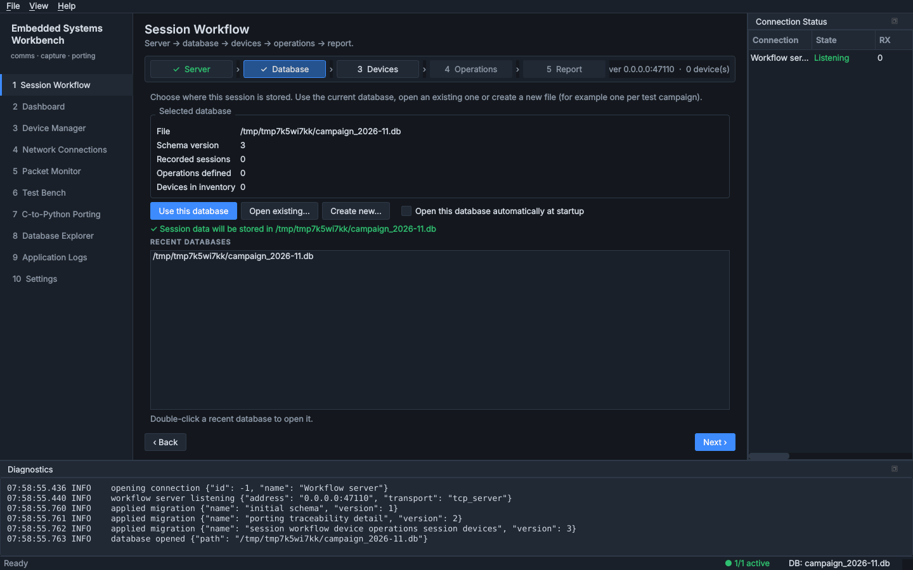
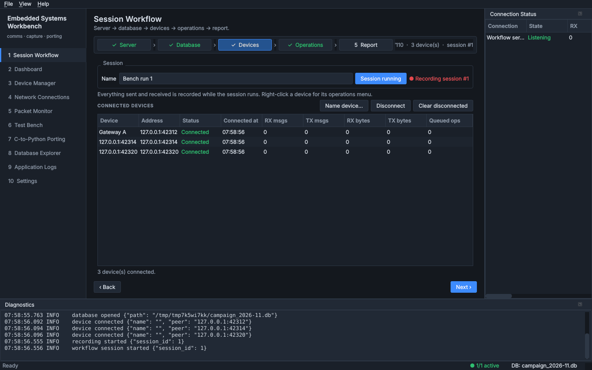
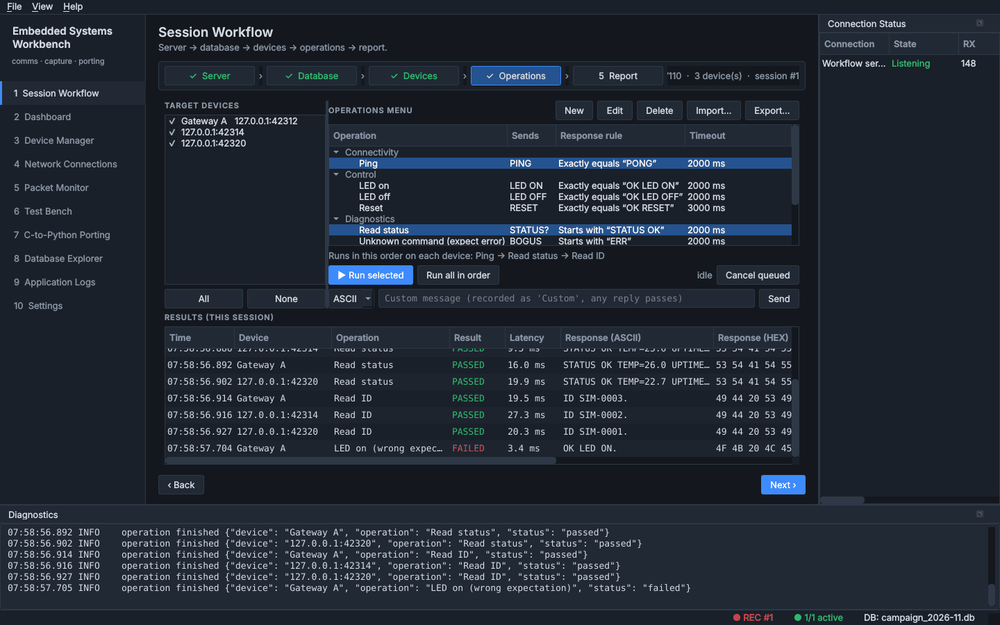
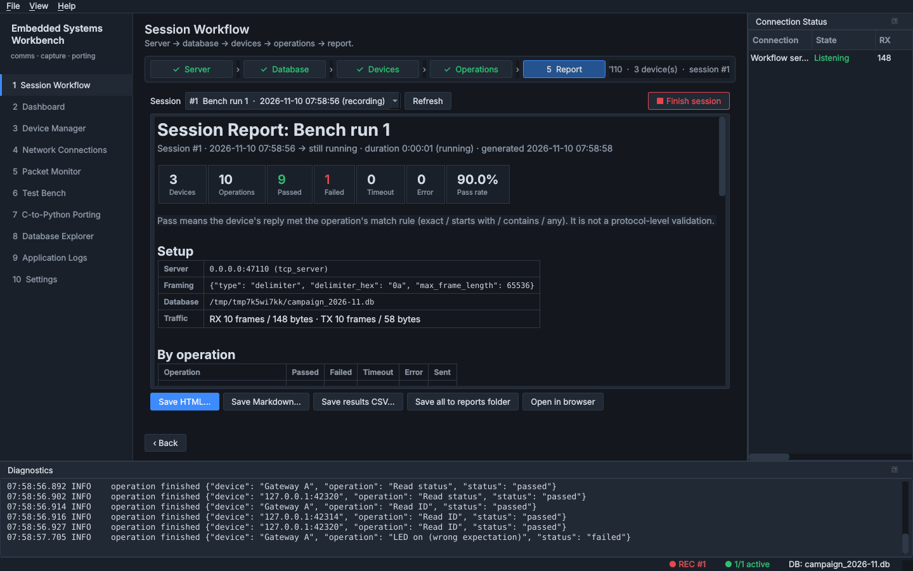
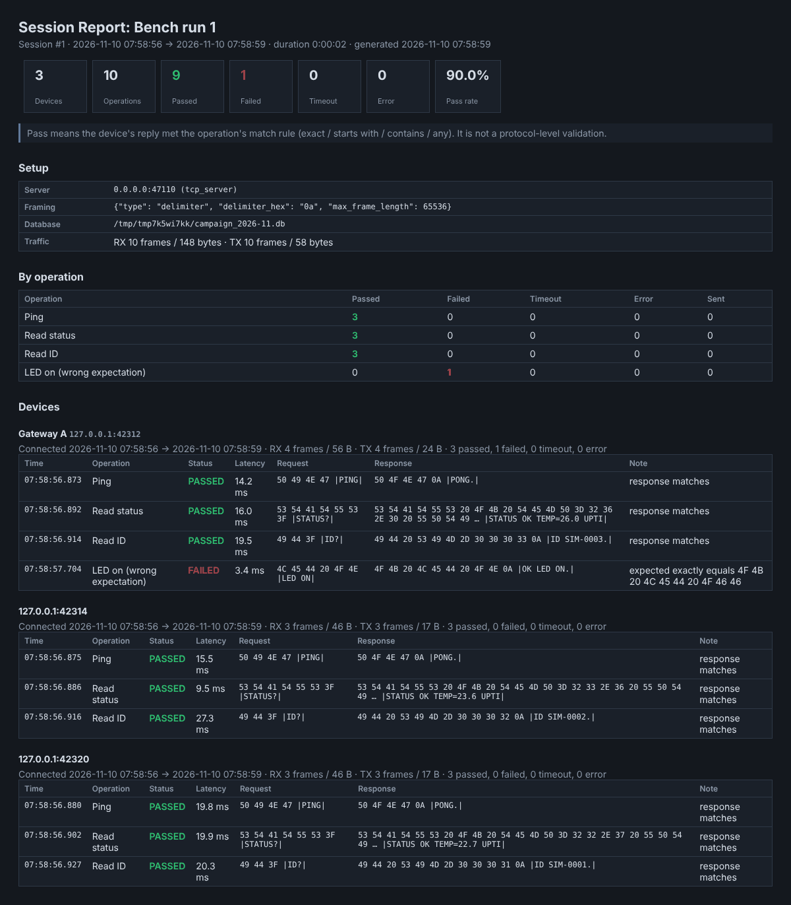
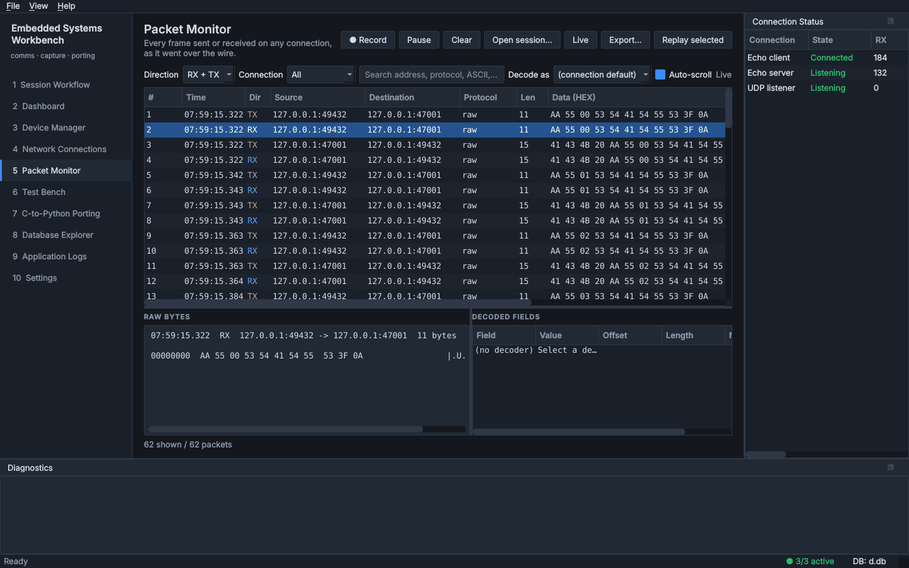
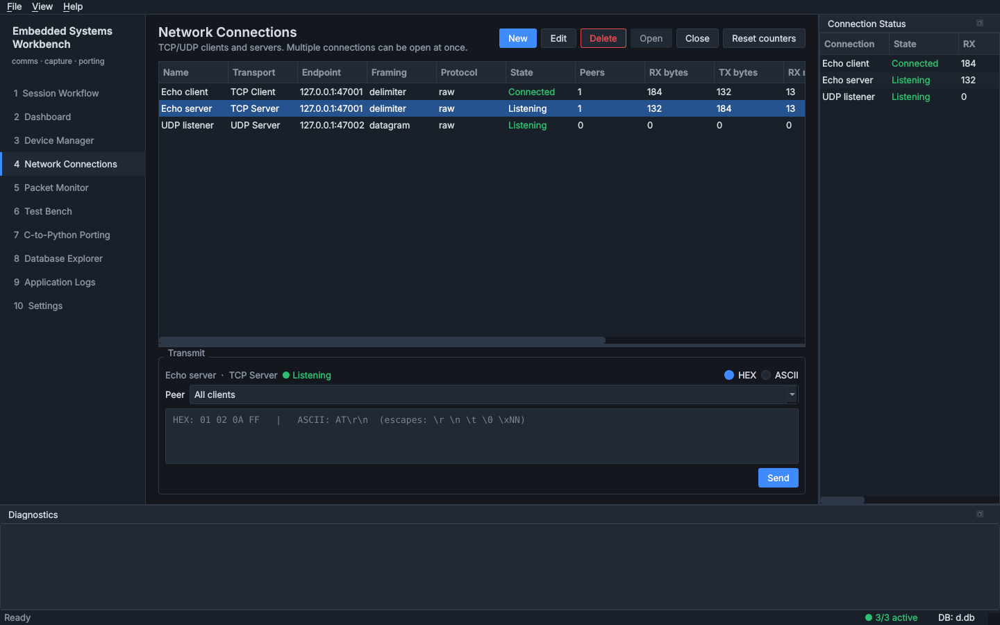
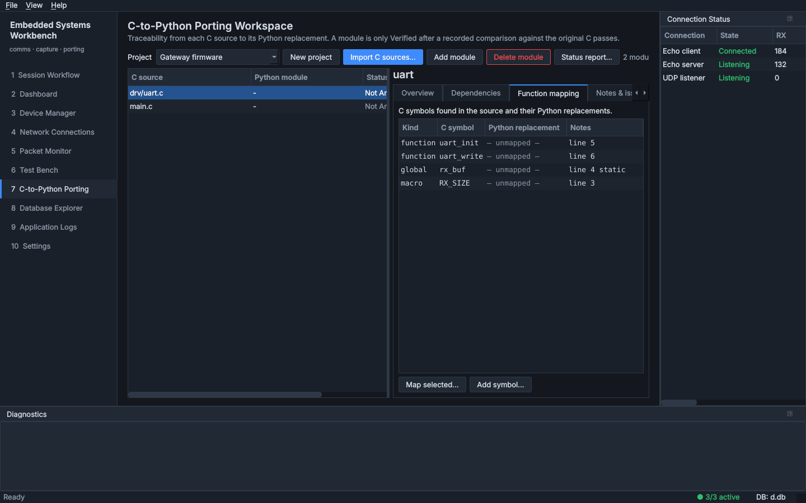
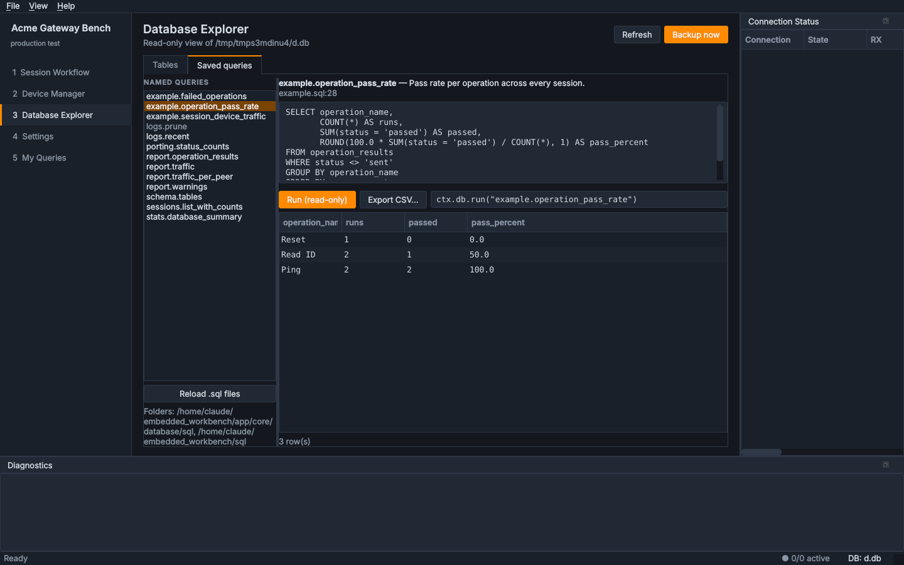

# Embedded Systems Workbench

PySide6 desktop application for embedded systems communication and testing,
and for porting existing C infrastructure to Python with verified functional
equivalence.

Current state: **initial scaffold + guided Session Workflow** — application shell, dark theme, ten
pages (including the five-step Session Workflow), SQLite persistence, TCP/UDP networking, packet monitor, test bench,
porting workspace and the embedded compatibility layer, with tests. No
project C code has been ported and no protocol is defined yet; that work
starts once the C sources are available.

## Screenshots

Captured from the application running offscreen with three simulated devices
(`tools/device_simulator.py`) talking to it over loopback.

### Session Workflow

| 1 · Server | 2 · Database |
|---|---|
|  |  |
| **3 · Devices** | **4 · Operations** |
|  |  |
| **5 · Report** | **Saved HTML report** |
|  |  |

### Other pages

| Packet Monitor | Network Connections |
|---|---|
|  |  |
| **C-to-Python Porting** | **Customised profile + saved SQL query** |
|  |  |

The last image is the same application started with a different
`project.json`: renamed, orange accent, only four built-in pages plus the
example plugin, running `example.operation_pass_rate` from `sql/example.sql`.

## Make it yours

This is a template. `project.json` sets the name, which pages appear and in
what order, plugins, SQL folders and colours. Named SQL queries live in
`sql/*.sql` and are called with `ctx.db.run("name", ...)`. Add pages with
`python tools/new_page.py <key> "<Title>" [--template NAME]` (see
`--list-templates`; add your own in `page_templates/`), pages that view and
edit a table with `python tools/new_page.py <key> "<Title>" --table <name>
[--database file.db]`, and tables with
`python tools/new_migration.py "<what>"`.

Step-by-step guides ([all guides](docs/guides/README.md)):

| I want to… | Guide |
|---|---|
| Rename the app, change its icon and colours, choose pages | [Branding and layout](docs/guides/branding-and-layout.md) |
| Add a table and a page to view and edit it | [Set up a database page](docs/guides/database-page.md) |
| Build a page of my own | [Build your own page](docs/guides/custom-page.md) |
| Put my device's commands in the workflow menu | [Set up operations for your device](docs/guides/device-operations.md) |
| See my frames as named fields | [Decode your device's frames](docs/guides/protocol-decoder.md) |
| Turn a C console menu into a workflow | [examples/led_device](examples/led_device/README.md) |

**[TEMPLATE.md](TEMPLATE.md)** is the reference for every option, and for
removing a feature's code entirely.

## Requirements

* Python 3.10+
* PySide6 6.6+ (developed and tested with 6.12.0)
* For the C reference tests: a C compiler on `PATH` (`cc`, `gcc` or `clang`;
  `$CC` is honoured)

## Setup

```bash
python -m venv .venv
# Linux:   source .venv/bin/activate
# Windows: .venv\Scripts\activate
pip install -r requirements-dev.txt
```

## Run

```bash
python main.py                      # uses data/config.json if present
python main.py --config my.json     # or set EWB_CONFIG
python main.py --project other.json # a different template profile (or EWB_PROJECT)
python main.py --smoke-test         # start, open every page, exit 0
```

Headless (CI / servers): set `QT_QPA_PLATFORM=offscreen`.

Runtime files go in `data/` by default: `workbench.db`, `logs/`, `backups/`.

## Test and check

```bash
pytest                              # everything
pytest tests/unit
pytest tests/integration            # real loopback sockets + offscreen GUI
pytest tests/compatibility          # incl. comparison with compiled C
pytest -m c_reference               # only the C comparison tests
ruff check app tests main.py
mypy app/core
```

The C reference tests compile `tests/fixtures/c_reference/reference.c` with
the host compiler and compare results through `ctypes`. Without a compiler
they are reported as **skipped**.

The Test Bench page can run the same suites from inside the application.

## Layout

```
embedded_workbench/
  main.py                    entry point
  app/
    context.py               composition root (builds all services)
    ui/                      presentation only
      main_window.py
      pages/                 workflow (5-step session), dashboard, devices, connections, packet_monitor,
                             test_bench, porting, database_explorer, logs, settings
      widgets/               Qt models, shared widgets
      dialogs/               device / connection / framing editors
      styles/theme.py        dark industrial theme
    core/
      models/                dataclasses and enums
      services/              WorkflowService, OperationRunner, DeviceService,
                             ConnectionManager, CaptureService, ProtocolService,
                             PortingService, TestRunner
      reporting/             session report (HTML / Markdown / CSV)
      networking/            TcpClient, TcpServer, UdpClient, UdpServer
      protocols/             decoder interface, registry, declarative decoder
      database/              connection mgmt, repositories, named-query loader
        schema/              migrations as numbered .sql files
        sql/                 built-in named queries
      compatibility/         fixed_int, endian, bits, crc, buffer,
                             serialization, framing, hal
      porting/               C source scanner, report renderer
      config.py, logging_setup.py, hexutil.py
  project.json               template profile (pages, plugins, SQL folders, theme)
  sql/                       your named SQL queries
  plugins/                   your pages (example_queries.py is an example)
  tools/device_simulator.py  demo devices for trying the workflow
  tools/new_page.py          generate a plugin page
  tools/new_migration.py     generate the next schema migration
  resources/command_sets/    example command set for the simulator
  tests/
    unit/  integration/  compatibility/  fixtures/c_reference/
  docs/guides/               step-by-step customisation guides
  docs/ARCHITECTURE.md  docs/PORTING_GUIDE.md
  resources/default_config.json
  data/                      runtime data (git-ignored)
```

## Session Workflow (guided, five steps)

The first page of the application walks through a device session:

| Step | What you do | Stored |
|---|---|---|
| **1 Server** | Choose TCP or UDP, bind IP (`0.0.0.0` = all interfaces), port and TCP message framing, then *Start server*. Devices connect to it. | last IP/port/framing in `data/config.json` |
| **2 Database** | *Use this database*, *Open existing…* or *Create new…* (e.g. one file per test campaign). Recent files are listed. | `recent_databases`, optional default |
| **3 Devices** | Watch devices connect, name them (optionally saving to the Device Manager), and *Start session*. Everything sent/received is recorded from here on. | `sessions`, `session_devices`, `packets` |
| **4 Operations** | Tick target devices, pick operations from the menu (grouped by category) and run them; several selected operations run in order on each device. Right-click a device in step 3 for the same menu. Custom one-off messages are recorded too. | `device_operations`, `operation_results` |
| **5 Report** | Preview the report for the current or any past session, *Finish session*, and save HTML / Markdown / results CSV (to `data/reports/` or anywhere). | report files |

Steps unlock in order (no devices without a server, no session without a
database). The server keeps running if you switch databases in step 2; you
cannot switch while a session is recording.

**Operations** are your own menu entries: bytes to send (ASCII with escapes
or HEX), a response rule (*no response*, *any response*, *exactly equals*,
*starts with*, *contains*) and a timeout. Enter the message itself: the
server framing (e.g. a newline delimiter) is added when sending and removed
from the reply before it is compared. Import/export command sets as JSON.
No device protocol is built in.

### Try it without hardware

```bash
python main.py
#  1 Server:   127.0.0.1, port 5000, framing "Delimiter" 0a -> Start server
#  2 Database: Use this database (or Create new…)
python tools/device_simulator.py --port 5000 --count 3      # in a second terminal
#  3 Devices:  three SIM devices appear -> Start session
#  4 Operations: Import… resources/command_sets/demo_simulator.json, tick devices, run
#  5 Report:   Finish session -> report saved to data/reports/
```

The simulator and its command set are a **demo protocol only** (PING/PONG,
ID?, STATUS? …), there to exercise the workflow. `--udp` simulates UDP devices.

## Using the application

* **Network Connections** — create TCP client/server or UDP client/server
  connections, choose stream framing (raw, delimiter, fixed, length-prefixed)
  and a decoder, open several at once, send HEX or ASCII (`\r \n \t \0 \xNN`).
* **Packet Monitor** — every frame in both directions with timestamps,
  addresses, HEX/ASCII and decoded fields; filter by direction/connection,
  search text or hex bytes; record to a session, reopen sessions, export
  CSV/JSON, replay selected frames.
* **Test Bench** — request/expected-response cases against live connections
  (byte-exact comparison), and the pytest suites.
* **C-to-Python Porting** — import a C tree, track status, dependencies,
  function mapping, notes, verification runs; generate a status report.
* **Database Explorer** — browse every table (BLOBs as hex), back up the DB.
* **Application Logs / Diagnostics dock** — structured log records.

Protocol decoders: user-defined declarative decoders are stored in the
`protocols` table (format documented in `app/core/protocols/declarative.py`);
code decoders for ported protocols register through
`ProtocolService.register()`.

## Development rules

See the project brief and `docs/PORTING_GUIDE.md`. In short: type hints,
PEP 8 (ruff), no business logic in widgets, never block the GUI thread, tests
alongside new code, configuration outside source, and no claim of
verification without an executed comparison against the C implementation.
