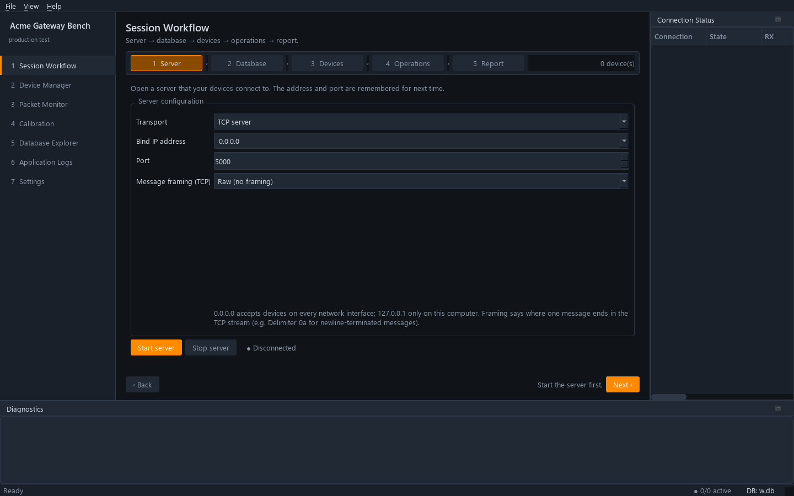

# Guide: make the app look like yours

Name, icon, colours, which pages appear and the defaults a new user starts
with. None of this needs code: it is all in `project.json` and a few
resource files.



*The same code started with the profile in [section 6](#6-several-looks-from-one-code-base): renamed, orange accent, seven pages including a plugin page.*

| Change | Where |
|---|---|
| Name, subtitle, organisation | `project.json` |
| Icon | an image file + `project.json → icon` |
| Colours | `project.json → theme` |
| Pages, order, start page | `project.json → pages`, `start_page` |
| Default settings for new machines | `resources/default_config.json` |
| Per-machine settings | `data/config.json`, edited in **Settings** (not committed) |

Restart the app after each change. `python main.py --smoke-test` checks that
the profile loads and every page opens.

---

## 1. Name

```json
"app_name": "Acme Gateway Bench",
"app_subtitle": "production test",
"organization": "Acme"
```

* `app_name` is the window title and the navigation heading.
* `app_subtitle` is the small line under it.
* `organization` with `app_name` identifies the app to the OS: window
  positions are saved under it, and on Windows the taskbar groups by it.

Also change, if you publish or package the project:

* `name` in `pyproject.toml`;
* the title and introduction of `README.md`;
* `<title>` inside `resources/icons/app.svg` if you keep that file.

## 2. Icon

1. Put your file in `resources/icons/`, for example `acme.svg`. `.svg`,
   `.png` and `.ico` work; SVG stays sharp at every size. For PNG use at
   least 256×256.
2. Point `project.json` at it:

   ```json
   "icon": "resources/icons/acme.svg"
   ```

The path is relative to the project root. An empty string uses Qt's default
icon. A missing file is logged and the app starts without it.

To edit the shipped icon instead, open `resources/icons/app.svg` in any text
editor: the colours are the theme's (`#1a2029` tile, `#3d8bfd` chip, `#2fbf71`
trace) and can be changed to match your theme.

## 3. Colours

Override only the colours you want; the rest keep their defaults.

```json
"theme": {
  "accent": "#ff8a00",
  "accent_dim": "#8a4b00",
  "background": "#101418"
}
```

| Key | Used for | Default |
|---|---|---|
| `background` | Window background | `#14181e` |
| `panel` | Navigation, panels, table backgrounds | `#1a2029` |
| `input` | Inputs, table headers, raised areas | `#212935` |
| `border` | Borders and separators | `#2e3846` |
| `text` | Normal text | `#d6dde6` |
| `text_dim` | Secondary text | `#8b97a7` |
| `accent` | Primary buttons, selection, focus | `#3d8bfd` |
| `accent_dim` | Selected rows, hover | `#24538f` |
| `ok` | Connected, passed | `#2fbf71` |
| `warning` | Warnings, timeouts | `#e0a526` |
| `error` | Errors, failed, invalid fields | `#e5484d` |
| `rx` / `tx` | Received / sent traffic in the monitors | `#5fb3ff` / `#f0a35e` |

Colours are `#rrggbb`. An unknown key or invalid colour stops start-up with
a message naming it. The app has one dark theme; for a light look, set
`background`, `panel`, `input` and `border` to light colours and `text`,
`text_dim` to dark ones, and check every page, since status colours were
chosen for a dark background.

In your own pages, use `theme.OK`, `theme.ERROR`, `theme.ACCENT`, … from
`app.ui.styles.theme` so they follow these settings
([custom page guide](custom-page.md#4-widgets-and-styles-that-match-the-app)).

## 4. Pages

```json
"pages": ["workflow", "devices", "packet_monitor", "calibration", "database", "logs", "settings"],
"start_page": "workflow"
```

* Order in the list is order in the navigation.
* A built-in page not in the list is hidden. Its code stays, and putting the
  key back restores it.
* Plugin pages not in the list are added at the end. To hide a plugin page,
  remove it from `plugins` instead.
* Leave out `pages` entirely to show every page.

Built-in keys: `workflow`, `dashboard`, `devices`, `connections`,
`packet_monitor`, `test_bench`, `porting`, `database`, `logs`, `settings`.

Typical cuts:

| Project | Pages |
|---|---|
| Production test station | `workflow`, `devices`, `logs`, `settings` |
| Protocol bring-up | `connections`, `packet_monitor`, `test_bench`, `database`, `logs`, `settings` |
| C porting only | `porting`, `test_bench`, `logs`, `settings` |

To delete a feature's code rather than hide it, follow
[TEMPLATE.md, section 6](../../TEMPLATE.md#6-remove-a-features-code-entirely).

## 5. Default settings

`resources/default_config.json` holds the settings every machine starts
with. A key missing from a machine's `data/config.json` falls back to it.
Useful keys to preset for your users:

| Key | Default | Meaning |
|---|---|---|
| `database_path` | `data/workbench.db` | Application database |
| `reports_dir` | `data/reports` | Where session reports are saved |
| `workflow_server_host` / `workflow_server_port` | `0.0.0.0` / `5000` | Session Workflow server address |
| `workflow_server_transport` | `tcp_server` | `tcp_server` or `udp_server` |
| `workflow_server_framing` | `{"type": "raw"}` | See [framing](device-operations.md#1-choose-the-framing) |
| `default_timeout_ms` | `5000` | Network timeouts |
| `log_level` | `INFO` | `DEBUG` for more detail |

Each machine's own changes (made in **Settings** or by the workflow) go to
`data/config.json`, which is git-ignored. Saving writes every setting there,
so a machine that has saved once no longer picks up later changes to the
defaults. Delete its `data/config.json` to start from the defaults again.

## 6. Several looks from one code base

Keep one profile per product or customer and choose one at start-up. The
screenshot at the top of this guide is this profile:

```json
{
  "app_name": "Acme Gateway Bench",
  "app_subtitle": "production test",
  "organization": "Acme",
  "icon": "resources/icons/app.svg",
  "pages": ["workflow", "devices", "packet_monitor", "calibration", "database", "logs", "settings"],
  "start_page": "workflow",
  "plugins": ["plugins.calibration", "plugins.led_protocol"],
  "sql_dirs": ["sql"],
  "theme": {"accent": "#ff8a00", "accent_dim": "#8a4b00", "background": "#101418"}
}
```

`calibration` and `led_protocol` are the plugins from the
[database page](database-page.md) and [decoder](protocol-decoder.md) guides.

```bash
python main.py --project profiles/acme.json
# or set EWB_PROJECT=profiles/acme.json
```

Each profile is a complete `project.json` (name, icon, theme, pages,
plugins). Paths inside it are relative to the project root.
