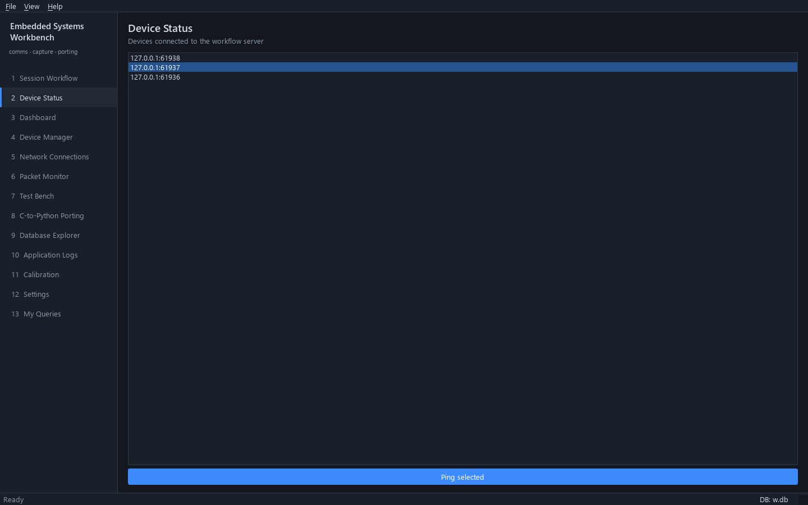

# Guide: build your own page

A page is one Python file in `plugins/` with a `QWidget` class and a
`register(registry)` function. This guide covers creating one, what it can
use, the widgets and styles that match the rest of the app, and how to
rename or remove it later.



*The Device Status page from [section 3](#3-what-ctx-gives-you), with three simulated devices connected.*

For a page that views and edits a database table, see
[Set up a database page](database-page.md) instead.

---

## 1. Create it

```bash
python tools/new_page.py --list-templates
python tools/new_page.py status "Device Status" --template blank
```

| Template | Pick it when the page… |
|---|---|
| `table` (default) | shows the result of one named query, with a Refresh button |
| `blank` | needs a layout of your own |
| `query_form` | runs a named query with inputs for its `:parameters` (set `QUERY`) |
| `live_packets` | shows traffic as it arrives (filter in `accepts()`) |
| `device_console` | sends bytes to a connection and logs the replies |
| `db_table` | views and edits a table (`--table`, `--database`) |
| `workflow` | guides the user through steps that unlock in order (replace the example steps) |
| `device_workflow` | runs a device session of your own: server, devices, operations, results |

The tool writes `plugins/status.py` and adds two entries to `project.json`:
`"plugins.status"` in `plugins` and `"status"` in `pages`. Restart the app
(`python main.py`) to see it. Use `--no-enable` to leave `project.json`
alone until the page is ready.

## 2. The shape of a page

```python
from PySide6.QtWidgets import QVBoxLayout, QWidget

from app.ui.widgets.common import PageHeader


class DeviceStatusPage(QWidget):
    def __init__(self, ctx, parent: QWidget | None = None) -> None:
        super().__init__(parent)
        self.ctx = ctx                                    # every service lives here
        layout = QVBoxLayout(self)
        layout.setContentsMargins(18, 14, 18, 14)         # same margins as the built-in pages
        layout.addWidget(PageHeader("Device Status", "One line saying what this page is for"))
        # ... your widgets ...


def register(registry) -> None:
    registry.add_page("status", "Device Status", DeviceStatusPage, description="Device Status")
```

The page is built once, when the app starts, and kept while it runs. To
refresh data each time the user opens the page, override `showEvent` (the
`db_table` template does this).

`register()` can also:

```python
registry.add_page("devices", "My Devices", MyDevicesPage, replace=True)  # replace a built-in page
registry.on_startup(lambda ctx: ...)   # run once after every service exists
```

## 3. What `ctx` gives you

| `ctx.` | Use it for | Useful members |
|---|---|---|
| `db` | The application database | `run`, `run_one`, `run_scalar`, `run_write`, `transaction()`, `query(sql, params)` |
| `workflow` | The Session Workflow's server, devices and session | `connected_devices()`, `session_id`, `server_id`, signals `devices_changed`, `session_changed`, `server_state_changed` |
| `operations` | Running device operations | signal `result_ready(dict)` |
| `connections` | Every open connection | `configs()`, `send(id, data, peer=None)`, signal `packet(Packet)` |
| `capture` | Live packet buffer and recording | signal `packets_added` (batched) |
| `devices` | The Device Manager's inventory | |
| `protocols` | Frame decoders | `decode(packet)`, `register(decoder)` |
| `config` | Per-machine settings (`data/config.json`) | `resolve(path)` for project-relative paths |
| `porting`, `tests` | Porting workspace and Test Bench | |

Example: a page that lists the connected workflow devices and sends one of
them a command.

```python
from PySide6.QtWidgets import QListWidget, QPushButton


...
        self.devices = QListWidget()
        layout.addWidget(self.devices, 1)
        ping = QPushButton("Ping selected")
        ping.setObjectName("Primary")
        ping.clicked.connect(self.ping_selected)
        layout.addWidget(ping)
        ctx.workflow.devices_changed.connect(self.reload_devices)
        self.reload_devices()

    def reload_devices(self) -> None:
        """List the devices connected to the workflow server."""
        self.devices.clear()
        for device in self.ctx.workflow.connected_devices():
            if device.connected:
                self.devices.addItem(device.peer)

    def ping_selected(self) -> None:
        """Send the ping frame to the selected device through the workflow server."""
        item = self.devices.currentItem()
        if item and self.ctx.workflow.server_id is not None:
            self.ctx.connections.send(self.ctx.workflow.server_id, bytes.fromhex("01 12"), peer=item.text())
```

The server's framing is added when sending, and the reply arrives through
`ctx.connections.packet` (and is recorded if a session is running).

## 4. Widgets and styles that match the app

From `app.ui.widgets.common`:

| Widget / function | What it is |
|---|---|
| `PageHeader(title, subtitle)` | The title row at the top of every page. Add buttons to `header.actions` to place them at its right. |
| `StatCard(label, value)` | A large number with a caption, as on the Dashboard. `card.set_value("12", color)`. |
| `StatusDot()` | Coloured state text such as "● Connected". `dot.set_state("Connected")` (any `ConnectionState` value). |
| `HexView()` | A read-only monospace box for hex dumps. |
| `configure_table(view)` | Standard look for a `QTableView`/`QTableWidget`: row selection, stretch last column. |
| `show_error(parent, title, exc)` | An error dialog for a caught exception. |
| `section_label(text)` | A small heading inside a page. |

Object names give widgets the theme's special styles:

```python
button.setObjectName("Primary")   # accent-coloured main action
button.setObjectName("Danger")    # red outline, for destructive actions
label.setObjectName("Dim")        # secondary text
```

Colours come from `app.ui.styles.theme` (`theme.OK`, `theme.ERROR`,
`theme.ACCENT`, `theme.WARN`, `theme.TEXT_DIM`, …) and follow `project.json → theme`, so use those names
instead of hard-coded colours.

## 5. Rules that keep the app responsive and testable

* **Never block the GUI thread.** No `time.sleep`, no blocking sockets, no
  `subprocess.run` in a page. Networking is already asynchronous: send with
  `ctx.connections.send` and react to signals. For a delay, use
  `QTimer.singleShot(ms, callback)`; for repeating work, a `QTimer`.
* **Keep logic out of the widget.** Put parsing, calculations and database
  work in plain functions or a small service class (for example in
  `plugins/status_logic.py`) and test those with pytest. The widget only
  wires them to buttons and labels.
* **Keep docstrings.** New functions use Google-style docstrings (summary,
  then `Args:` / `Returns:` / `Raises:`), like the generated file.

A test for page logic needs no Qt:

```python
# tests/unit/test_status_logic.py
from plugins.status_logic import summarise


def test_summarise_counts_devices():
    assert summarise(["a", "b"]) == "2 devices"
```

## 6. Change, rename or remove a page later

| To change | Do this |
|---|---|
| The navigation title | The second argument of `registry.add_page(...)`, and the `PageHeader(...)` title |
| The position in the navigation | Move the key in `"pages"` in `project.json` |
| The start page | `"start_page": "status"` in `project.json` |
| The file name | Rename the file **and** change `"plugins.<old>"` to `"plugins.<new>"` in `project.json` |
| The page key | Change it in `add_page(...)` **and** in `"pages"` in `project.json` |
| Hide it | Remove `"plugins.<file>"` from `"plugins"` (removing it from `"pages"` alone is not enough) |
| Remove it | Delete the file and both `project.json` entries |
| Keep it out of git | Name the file `plugins/local_<name>.py` (`.gitignore` skips it). Its `project.json` entries are still shared, so add them only on your machine or in a `*.local.json` profile started with `--project`. |

The file name and the page key are separate: `plugins/status_page.py` can
register the key `status`. The two messages you see when they don't match:

* `ModuleNotFoundError: No module named 'plugins.status'`: the `plugins`
  entry names a file that does not exist. Use the file's name
  (`"plugins.status_page"`).
* `project.json lists unknown page 'status_page'`: the `pages` entry names a
  key no plugin registered. Use the key from `add_page(...)` (`"status"`).

Check after every change:

```bash
python -m pytest tests/unit/test_template.py::test_shipped_project_json_is_valid
python main.py --smoke-test
```
