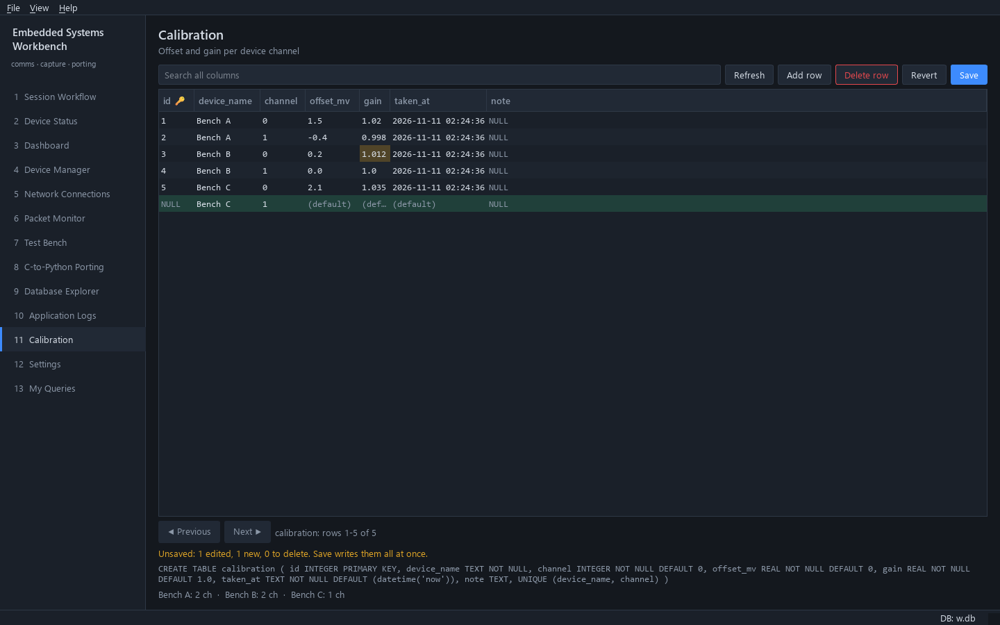

# Guide: set up a database page

This guide adds a table to the database and a page that views and edits it.
It uses a `calibration` table as the running example; swap in your own names.



*The page built in this guide, with one edited cell and one new row not yet saved.*

You need three things, each in its own file:

| Step | File | Made with |
|---|---|---|
| 1. The table | `app/core/database/schema/NNNN_*.sql` | `tools/new_migration.py` |
| 2. Queries over it (optional) | `sql/<name>.sql` | by hand |
| 3. The page | `plugins/<key>.py` | `tools/new_page.py --table` |

Already have your own SQLite file and don't want the workbench to touch it?
Skip to [Use your own database file](#use-your-own-database-file).

---

## 1. Create the table

```bash
python tools/new_migration.py "add calibration table"
```

This writes the next numbered file, for example
`app/core/database/schema/0004_add_calibration_table.sql`. It contains only
comments. Replace them with your statements, each ending in `;`:

```sql
-- Migration 4: add calibration table
CREATE TABLE calibration (
    id          INTEGER PRIMARY KEY,
    device_name TEXT    NOT NULL,
    channel     INTEGER NOT NULL DEFAULT 0,
    offset_mv   REAL    NOT NULL DEFAULT 0,
    gain        REAL    NOT NULL DEFAULT 1.0,
    taken_at    TEXT    NOT NULL DEFAULT (datetime('now')),
    note        TEXT,
    UNIQUE (device_name, channel)
);
CREATE INDEX idx_calibration_device ON calibration(device_name);
```

Start the app (`python main.py`). The migration runs on start-up, and on any
database you open in the Session Workflow. Check it in **Database Explorer
→ Tables**: `calibration` is listed.

Rules worth knowing before you go further:

* **Never edit a migration once it has run on a database you care about.**
  The app records which numbers ran and will not run one again. To change
  the table later, add another migration (`ALTER TABLE calibration ADD
  COLUMN …`).
* A file with only comments stops start-up with an error. Delete the file if
  you created it by mistake.
* Column types matter to the editor: `INTEGER` columns accept whole numbers
  only, `REAL` accepts numbers, `BLOB` is typed as hex, and `NOT NULL`
  columns refuse empty cells (empty text becomes `''` for `NOT NULL TEXT`).
* `DEFAULT` values are filled in for columns you leave empty in a new row.
* Give the table an `INTEGER PRIMARY KEY` (or leave it a normal rowid table).
  A `WITHOUT ROWID` table needs a primary key. A table with neither can be
  viewed but not edited.

## 2. Add queries (optional)

The editor page in step 3 needs no SQL. Add named queries when the page or
other code needs more than the raw rows: totals, joins, inserts from code.

Create `sql/calibration.sql`:

```sql
-- name: calibration.summary
-- Channels and last calibration time per device.
SELECT device_name, COUNT(*) AS channels, MAX(taken_at) AS last_taken
FROM calibration
GROUP BY device_name
ORDER BY device_name;

-- name: calibration.for_device
SELECT channel, offset_mv, gain, taken_at
FROM calibration
WHERE device_name = :device_name
ORDER BY channel;

-- name: calibration.upsert
-- Insert or replace one channel's calibration.
INSERT INTO calibration (device_name, channel, offset_mv, gain)
VALUES (:device_name, :channel, :offset_mv, :gain)
ON CONFLICT (device_name, channel)
DO UPDATE SET offset_mv = excluded.offset_mv, gain = excluded.gain,
              taken_at = datetime('now');
```

* `-- name:` starts a query, the `--` lines right after it describe it.
* `:name` is a parameter. One statement per query.
* Try them in **Database Explorer → Saved queries** (read-only there, so
  `calibration.upsert` is refused; it runs from code). Click **Reload .sql
  files** after editing.

Use them from Python:

```python
rows = ctx.db.run("calibration.for_device", device_name="LED-1")    # list of rows
row = ctx.db.run_one("calibration.summary")                         # first row or None
n = ctx.db.run_scalar("calibration.summary")                        # first column of the first row
ctx.db.run_write("calibration.upsert", device_name="LED-1", channel=0, offset_mv=1.5, gain=1.02)

with ctx.db.transaction():          # several writes, all or nothing
    for ch, (off, gain) in enumerate(values):
        ctx.db.run_write("calibration.upsert", device_name=name, channel=ch, offset_mv=off, gain=gain)
```

Rows behave like tuples and dicts: `row["gain"]`, `row[0]`, `dict(row)`.

## 3. Generate the page

```bash
python tools/new_page.py calibration "Calibration" --table calibration
```

This writes `plugins/calibration.py` from the `db_table` template and adds
`"plugins.calibration"` and `"calibration"` to `project.json`. Restart the
app and open **Calibration** in the navigation.

The page gives you, without any code:

* search across every column, and paging (200 rows per page);
* double-click a cell to edit it, **Add row**, **Delete row** (click again
  to unmark);
* **Save** writes every change in one transaction. If a constraint fails
  (here, a duplicate device and channel), nothing is written and your edits
  stay so you can fix them. **Revert** throws them away;
* changed, new and deleted rows are coloured until saved.

## 4. Adjust the generated page

Open `plugins/calibration.py`. The settings are at the top:

```python
TABLE = "calibration"
DATABASE = ""        # empty = the application database (ctx.db)
READ_ONLY = False
```

| You want | Change |
|---|---|
| A view-only page | `READ_ONLY = True` |
| A chooser of every table instead of one | `TABLE = ""` |
| A different file | `DATABASE = "data/plant.db"` (see below) |
| More or fewer rows per page | `TableEditor(self.db, TABLE, read_only=READ_ONLY, page_size=50)` |
| A different title or subtitle | The `PageHeader(...)` line, and the title in `registry.add_page(...)` |
| Its place in the navigation | Move `"calibration"` in `"pages"` in `project.json` |

Restart the app after every change. Pages are not reloaded while it runs.

### Add something next to the grid

The grid is a normal widget, `TableEditor`, so you can put other widgets
around it. Its `saved` signal fires after a successful Save with the number
of rows written. This version adds a summary line under the grid that
updates after every save:

```python
from PySide6.QtWidgets import QLabel, QVBoxLayout, QWidget

from app.ui.widgets.common import PageHeader
from app.ui.widgets.table_editor import TableEditor

TABLE = "calibration"


class CalibrationPage(QWidget):
    def __init__(self, ctx, parent: QWidget | None = None) -> None:
        """Show the calibration table with a per-device summary below it.

        Args:
            ctx: Application context with every service.
            parent: Optional parent widget.
        """
        super().__init__(parent)
        self.ctx = ctx
        layout = QVBoxLayout(self)
        layout.setContentsMargins(18, 14, 18, 14)
        layout.addWidget(PageHeader("Calibration", "Offset and gain per device channel"))
        self.editor = TableEditor(ctx.db, TABLE)
        self.editor.saved.connect(lambda _rows: self.update_summary())
        layout.addWidget(self.editor, 1)
        self.summary = QLabel("")
        self.summary.setObjectName("Dim")
        layout.addWidget(self.summary)
        self.update_summary()

    def update_summary(self) -> None:
        """Show how many channels each device has calibrated."""
        rows = self.ctx.db.run("calibration.summary")
        self.summary.setText("  ·  ".join(f"{r['device_name']}: {r['channels']} ch" for r in rows)
                             or "No calibration yet")


def register(registry) -> None:
    """Plugin entry point: add the calibration page.

    Args:
        registry: Page registry to add the page to.
    """
    registry.add_page("calibration", "Calibration", CalibrationPage, description="Calibration")
```

Other things you can do with the editor from code:

| Call | Does |
|---|---|
| `editor.set_table("other_table")` | Show another table (asks first if there are unsaved edits) |
| `editor.reload(ask=False)` | Re-read the rows, for example after your code wrote to the table |
| `editor.model.has_changes()` | True while there are unsaved edits |
| `editor.save_changes()` / `editor.revert_changes()` | What the buttons do |

### Fill the table from the device workflow

To store values a device reports, write them from a service or start-up hook
rather than from the page. For example, record every *Read temperature*
result in your own table:

```python
def register(registry) -> None:
    registry.add_page("calibration", "Calibration", CalibrationPage)

    def connect_results(ctx) -> None:
        def store(result: dict) -> None:
            if result["operation_name"] == "Read temperature" and result["status"] == "passed":
                ctx.db.run_write("calibration.store_reading", device_name=result["device_name"],
                                 raw=bytes(result["response"]))
        ctx.operations.result_ready.connect(store)

    registry.on_startup(connect_results)
```

`calibration.store_reading` is a query you would add to `sql/calibration.sql`.
A result carries `session_id`, `executed_at`, `peer`, `device_name`,
`operation_name`, `match_mode`, `request`, `expected`, `response` (the reply
bytes, or None), `status` (`passed`, `failed`, `timeout`, `sent` or `error`),
`latency_ms` and `message`.

## Use your own database file

When the app opens a file as its **application database** (in Settings or in
Session Workflow step 2), it adds the workbench's tables to it. To keep your
own file exactly as it is, open it from a page instead:

```bash
python tools/new_page.py plant "Plant data" --table readings --database data/plant.db
```

The page opens `data/plant.db` (relative to the project root, or an absolute
path) without running migrations or changing its journal mode. Everything
in steps 3 and 4 still applies.

Differences from the application database:

* **No migrations.** Create and change tables with your own tools (for
  example `sqlite3`, DB Browser for SQLite, or a script).
* **Named queries.** A file opened this way only knows the built-in queries.
  To call your `sql/*.sql` queries on it, share the app's query library
  after opening it:

  ```python
  self.db = open_database_file(str(ctx.config.resolve(DATABASE)))
  self.db.sql = ctx.db.sql
  rows = self.db.run("plant.daily_totals")
  ```

  Or use plain SQL: `self.db.query("SELECT … WHERE id = ?", (5,))`.
* **Quick look without a page:** **Database Explorer → Open file…** browses
  any SQLite file read-only. **Workbench database** switches back.

## Troubleshooting

| Symptom | Cause and fix |
|---|---|
| Page says the table does not exist | The migration did not run on this database (wrong file in Settings, or the app was not restarted), or the name in `TABLE` is misspelled. |
| Start-up error naming your migration | A statement failed or the file has only comments. Fix the file; nothing from a failed migration is kept. |
| Editing buttons are missing | `READ_ONLY = True`, or the table has no rowid and no primary key. |
| Save fails with `UNIQUE constraint failed` | Two rows share a unique value. Fix the cell and Save again; nothing was written. |
| `unknown SQL query 'calibration.summary'` | The file is not in a folder listed in `sql_dirs`, the `-- name:` line is misspelled, or the app was not restarted. |
| The Database Explorer does not show the workbench's tables | They are hidden on purpose. Tick **Show workbench tables**. |

Then check the whole project:

```bash
python main.py --smoke-test     # every page opens
pytest
```
