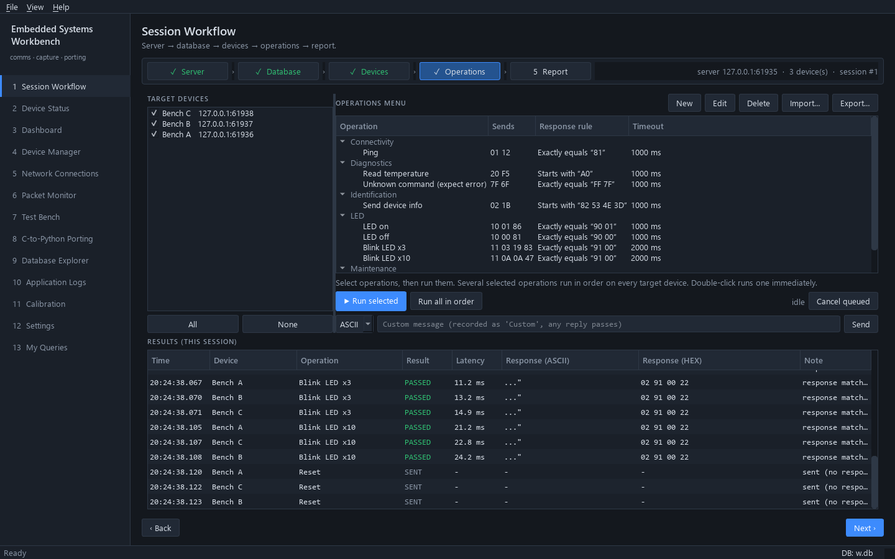

# Guide: set up operations for your device

Operations are the menu in **Session Workflow → 4 Operations**: each one is
bytes to send, a rule that judges the reply, and a timeout. This guide covers
choosing the framing, writing operations by hand or as a JSON command set,
and generating them from code.

For a full worked example (a C console menu turned into operations, with a
dummy device to try it on) see [examples/led_device](../../examples/led_device/README.md).



*The LED command set after **Run all in order** on three simulated devices. Reset expects no reply, so it is SENT rather than PASSED.*

---

## 1. Choose the framing

TCP is a byte stream, so the server needs to know where one message ends.
Set this in **1 Server → Message framing** before starting the server. UDP
needs no framing: one datagram is one message.

| Your device's messages | Framing | Options |
|---|---|---|
| Text lines ending in `\n` or `\r\n` | **Delimiter** | `0a` or `0d0a` |
| Always the same size | **Fixed length** | the size in bytes |
| Start with a length field | **Length prefixed** | see below |
| One message per TCP packet, or you can't tell | **Raw (no framing)** | none (works only if the device never splits or joins messages) |

**Length prefixed** options:

| Option | Meaning |
|---|---|
| Field size | 1, 2 or 4 bytes |
| Byte order | `big` or `little` |
| Offset | Header bytes **before** the length field (a sync byte = 1) |
| Length adjust | Added to the field to get the bytes after it. `0` if the field counts exactly the bytes after it; `+2` if a 2-byte CRC follows uncounted; `-header_size` if the field counts the whole frame. |

The framing is added when sending and removed from each reply before it is
compared, so operations contain only the message itself.

As JSON (used by `data/config.json` and by command sets for reference):

```json
{"type": "delimiter", "delimiter_hex": "0a"}
{"type": "fixed", "length": 16}
{"type": "length_prefixed", "length_size": 2, "byte_order": "little", "length_offset": 1, "length_adjust": 2}
```

## 2. Write an operation in the app

**4 Operations → New**:

| Field | What to enter |
|---|---|
| Name | What the menu shows. Names are unique; importing an operation with the same name updates it. |
| Category | Groups the menu (Connectivity, LED, Diagnostics, …). |
| Payload | `HEX` (`01 12`, `0x01,0x12` and `0112` all work) or `ASCII` (with escapes `\r \n \t \0 \xNN`). |
| Match | How the reply is judged, see below. |
| Expected | The bytes the rule compares against, in the same format as the payload. |
| Timeout | How long to wait for a reply, in ms. |

| Match | Passes when | Use for |
|---|---|---|
| `none` | Sending succeeds (no reply is awaited; status `sent`) | Reset, reboot, fire-and-forget commands |
| `any` | Any reply arrives in time | Commands whose reply varies completely |
| `exact` | The reply equals Expected | Fixed acknowledgements |
| `prefix` | The reply starts with Expected | A fixed header followed by data (IDs, versions, readings) |
| `contains` | Expected appears anywhere in the reply | Text replies with a keyword |

Each run is stored with the reply and a status: `passed`, `failed`,
`timeout`, `sent` or `error` (send failed, device disconnected, cancelled).

## 3. Keep operations in a command set file

A command set is a JSON file you can commit, share, and load with
**Import…**. **Export…** writes the current menu in the same format.

```json
{
  "description": "Acme sensor, firmware 2.x. Server framing: Delimiter 0d0a.",
  "operations": [
    {
      "name": "Read ID",
      "category": "Identification",
      "description": "Serial number",
      "payload_format": "ascii",
      "payload": "*IDN?",
      "match": "prefix",
      "expected": "ACME,",
      "timeout_ms": 1000
    }
  ]
}
```

| Key | Required | Default |
|---|---|---|
| `name`, `payload` | yes | |
| `payload_format` | | `hex` |
| `match` | | `any` |
| `expected` | | `""` |
| `timeout_ms` | | `2000` |
| `category` | | `General` |
| `description` | | `""` |

Operations appear in the file's order. On import the app asks whether to
**replace** the menu or **merge** (same names are updated). If one entry is
invalid, nothing is imported.

A `framing` key at the top level is not applied on import; it is there to
document the server setting for whoever uses the file. Put the setting in
`description` too.

Store your files in `resources/command_sets/`, where **Import…** opens by
default.

## 4. Generate a command set from code

When payloads include a CRC, a struct layout or byte-order conversions,
compute them once in a script instead of by hand.
`examples/led_device/make_command_set.py` is a complete generator; the core
of it is:

```python
import json
from pathlib import Path

from app.core.compatibility.crc import CRC8, Crc

crc = Crc(CRC8)


def request(cmd: int, data: bytes = b"") -> str:
    body = bytes([cmd]) + data
    return (body + bytes([crc.compute(bytes([len(body)]) + body)])).hex(" ")


operations = [
    {"name": "Ping", "payload_format": "hex", "payload": request(0x01), "match": "exact", "expected": "81"},
    {"name": "LED on", "payload_format": "hex", "payload": request(0x10, b"\x01"), "match": "exact", "expected": "90 01"},
]
Path("resources/command_sets/my_device.json").write_text(json.dumps({"operations": operations}, indent=2))
```

Run it from the project root (`python path/to/script.py`) so `app` can be
imported. Helpers for reproducing C behaviour:

| Module | For |
|---|---|
| `app.core.compatibility.crc` | Any CRC from its parameters (`CRC8`, `CRC16_CCITT_FALSE`, … or your own) |
| `app.core.compatibility.serialization` | C struct layouts, packing and unpacking |
| `app.core.compatibility.endian` | Byte order |
| `app.core.compatibility.fixed_int` | C integer wrap-around (`uint8_t`, `int16_t`, …) |

Add a test that the committed JSON matches the generator, as
`tests/integration/test_examples.py::test_led_command_set_is_up_to_date`
does, so the two never drift apart.

## 5. When a fixed operation is not enough

Operations send the same bytes every time. Use a page instead when:

* the frame changes per send (sequence number, timestamp, a counter);
* the user types a value ("blink N times") — or add one operation per common
  value;
* a reply must be parsed and checked with logic (ranges, CRC of the reply).

Create one with `python tools/new_page.py <key> "<Title>" --template
device_console`, and see [Build your own page](custom-page.md) for sending
to workflow devices. To store results in your own table, see
[Fill the table from the device workflow](database-page.md#fill-the-table-from-the-device-workflow).

To see replies as named fields in the Packet Monitor, add a
[protocol decoder](protocol-decoder.md).

## Troubleshooting

| Symptom | Likely cause |
|---|---|
| Every operation times out, but the Packet Monitor shows replies | Wrong framing: the reply never forms a complete frame. Check the length options or delimiter. |
| `failed` although the reply looks right | Expected includes framing bytes (length, delimiter, CRC trailer), or the payload format differs (`ASCII` vs `HEX`). |
| Replies are merged or cut in two | Raw framing on a stream; choose a real framing. |
| A device does not appear in step 3 | It connects to a different IP/port, or a firewall blocks it. `0.0.0.0` listens on every interface. |
