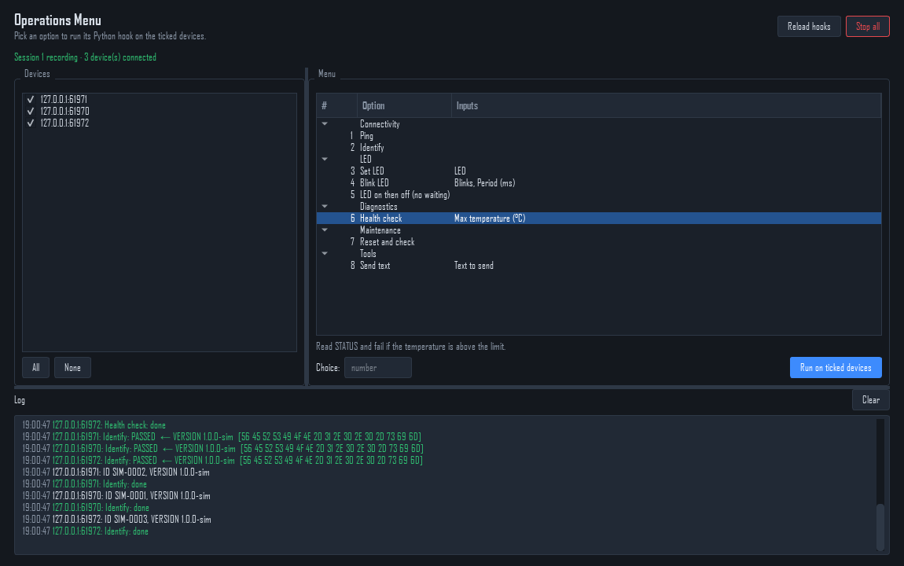

# Menu hooks: run Python functions from a numbered menu

The **Operations Menu** page is a menu of options, like a C test console.
Each option is a Python function (a *hook*) in your project. Pick an option
and its function runs on every ticked device. The function can send
commands, wait for replies, look inside them, decide what to send next, ask
for inputs and fail with a reason.

Use it next to the Session Workflow's operations step: fixed operations
(send these bytes, expect that reply) stay there; anything that needs logic
goes here.



## 1. Try the example

1. **Session Workflow:** start the server with framing **Delimiter 0a**,
   confirm a database, start the demo devices and start a session:

   ```bash
   python tools/device_simulator.py --port 5000 --count 3
   ```

2. **Operations Menu:** the devices are listed on the left, all ticked. Pick
   an option and double-click it, click **Run on ticked devices**, or type its
   number in **Choice** and press Enter. Options with inputs ask for them
   first; the last values are remembered.
3. Read the **Log**: every request with its reply and result, your hooks'
   own messages, and `done` / `failed` per device.

Every request is also stored in `operation_results` under the session, so
the step 5 report includes it.

The options come from `plugins/example_menu.py`, listed in `project.json`:

```json
"menu_hooks": ["plugins.example_menu"]
```

## 2. Write your own hooks

Create a file, for example `plugins/my_device_menu.py`, and add it to
`menu_hooks`:

```python
from app.core.services.menu_hooks import Param, menu_option


@menu_option("Ping", category="Connectivity")
def ping(dev):
    """Check the device answers."""
    reply = yield dev.request("PING", expect="PONG")
    if not reply:
        dev.fail(reply.message)


@menu_option("Set speed", category="Motor", params=[
    Param("rpm", 1200, label="Speed (rpm)", minimum=0, maximum=6000),
    Param("ramp", True, label="Soft start"),
])
def set_speed(dev, rpm, ramp):
    """Set the motor speed, then read it back."""
    yield dev.request(f"SPEED {rpm} {'RAMP' if ramp else 'NOW'}", expect="OK")
    yield dev.wait(1000)
    reply = yield dev.request("SPEED?", expect="SPEED ", match="prefix")
    actual = int(reply.text.split()[1])
    dev.log(f"running at {actual} rpm")
    if abs(actual - rpm) > 50:
        dev.fail(f"speed {actual} rpm, wanted {rpm}")
```

Then press **Reload hooks**: the file is imported again, so you can edit and
retry without restarting the program.

* The **title** is the menu text and **category** its group. The menu is
  numbered top to bottom.
* The **docstring**'s first paragraph is the help text under the menu.
* Each **`Param`** becomes an input in a small dialog and is passed by name.

### What a hook can do

| In the hook | Does |
|---|---|
| `reply = yield dev.request(payload, expect=..., match="exact")` | Sends and waits for the reply. `match` is `"exact"`, `"prefix"` or `"contains"`; no `expect` accepts any reply. Optional: `timeout_ms=2000`, `name="..."` (the name stored in the results). |
| `yield dev.send(payload)` | Sends without waiting for a reply. |
| `yield dev.wait(500)` | Pauses 500 ms; the window stays responsive. |
| `dev.log("text")` | Writes a line to the log. |
| `dev.fail("reason")` | Stops the hook; the run is marked **failed**. |
| `dev.name`, `dev.peer` | The device's name and address. |

**`yield` means "wait for this".** Without `yield`, requests are still queued
and run in order, but the hook does not see their replies. A hook with no
`yield` at all is an ordinary function that finishes at once.

**Payloads** are `bytes` or text. Text is sent as UTF-8 (`"PING"`). For binary
protocols, build bytes: `bytes.fromhex("01 12")`, `bytes([cmd, value])`,
`struct.pack(">hB", value, flags)`. The server's framing (delimiter, length
header) is added and removed for you, as for every operation.

**A `Reply`** has:

| Attribute | Value |
|---|---|
| `reply.passed` (or just `if reply:`) | True if the reply matched `expect` |
| `reply.status` | `passed`, `failed`, `timeout`, `sent` or `error` |
| `reply.data` | The reply bytes without framing, or `None` |
| `reply.text` | The reply as text, without the line ending |
| `reply.message` | Why it failed, e.g. `no response within 2000 ms` |

### Param inputs

| `Param(...)` | Input |
|---|---|
| `Param("count", 3, minimum=1, maximum=10)` | whole number |
| `Param("limit", 45.0)` | decimal number |
| `Param("text", "hello")` or `Param("text")` | text |
| `Param("enabled", True)` | checkbox |
| `Param("mode", "fast", choices=["fast", "slow"])` | drop-down |

`label=` sets the text shown next to the input; `kind=` forces a type, e.g.
`Param("gain", 1, kind=float)`.

## 3. From a C console menu

`examples/led_device/menu_hooks.py` is the C program `console_menu.c` as
hooks: one function per `case`, `send_cmd()` as a small `request()` helper
that adds the CRC, and replies decoded in Python (temperature, serial
number). To try it, add it to `project.json`:

```json
"menu_hooks": ["plugins.example_menu", "examples.led_device.menu_hooks"]
```

Start the workflow server with the LED example's framing (see
[examples/led_device](../../examples/led_device/README.md)) and run
`python examples/led_device/led_device_sim.py --port 5000 --count 3`.

## 4. Put the menu inside the Session Workflow

By default the menu has its own tab, and step 4 (Operations) of the Session
Workflow shows the fixed operations from command sets. To make step 4 show
the menu hooks instead, set one line in `project.json`:

```json
"workflow_operations": "menu"
```

Restart the program. Then:

* **Step 4** is the Operations Menu, with the same devices, numbered menu,
  Reload hooks, Stop all and log, under the workflow's step bar.
* **Step 3:** **Operations for selected…** opens step 4 with those devices
  ticked, and right-clicking a device → **Run operation** lists your hook
  options by category.
* Results are stored under the session as before, so **step 5** reports them.

The separate **Operations Menu** tab still exists. To have the menu only in
the workflow, remove `"operations_menu"` from `pages` in `project.json`.

For a different layout in step 4 (C-style console, buttons, form or test
sequence), see [Pick a layout for the operations menu](menu-templates.md).

To go back, set `"workflow_operations": "operations"` (the default). Command
sets you imported are not deleted while the menu is in step 4; they are just
not shown.

## Errors

A mistake in a hook never stops the program. The log shows it in red with
the line number, for example `ValueError: invalid literal for int() (line 42)`,
and that device's run ends as **error**. A hook file that does not import
(syntax error, missing module) is reported when it is loaded; fix it and press
**Reload hooks**.

**Stop all** stops every running hook. Requests already sent still finish and
are recorded.

## Check

* The page says `Session N recording · K device(s) connected`. If it asks you
  to start the server or a session, do that in the Session Workflow.
* Your options appear, numbered, under their categories.
* Running one logs `done` for each ticked device.
* In a packaged executable (`tools/build_exe.py`), hook files sit in
  `plugins/` next to the `.exe` and can still be edited. If a hook starts
  importing a module the build did not include, build again.
