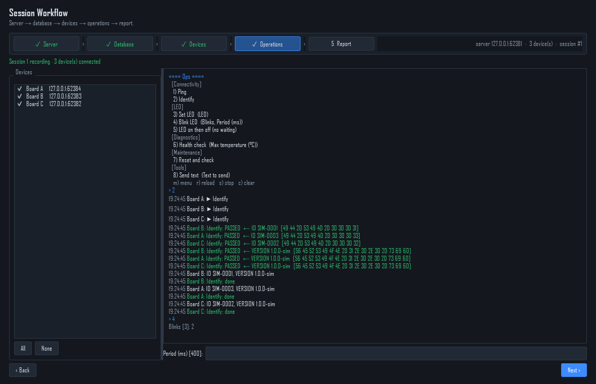
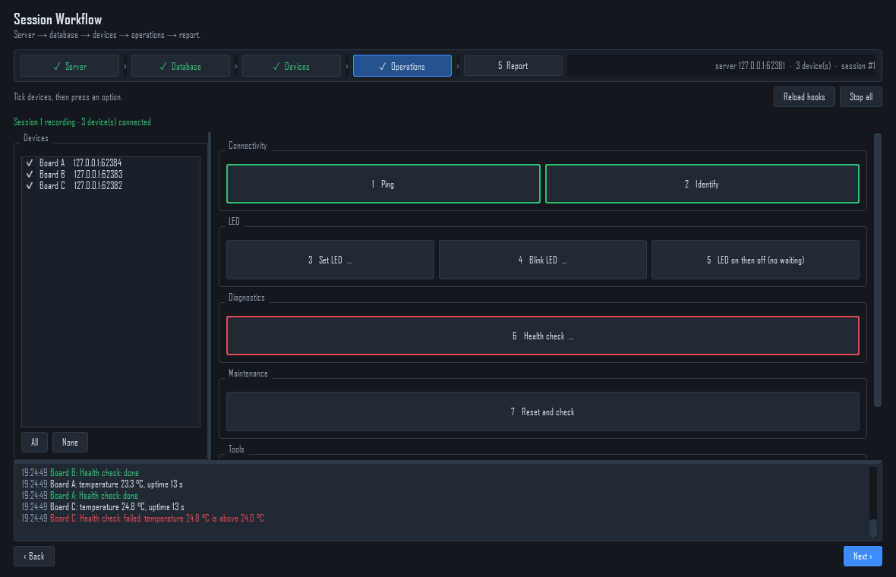
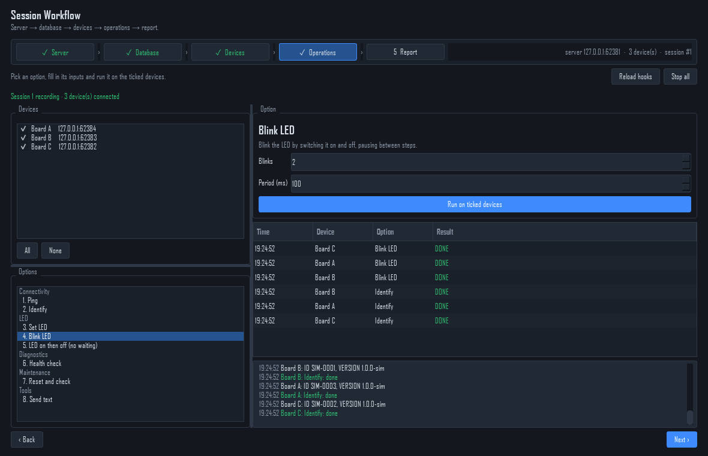
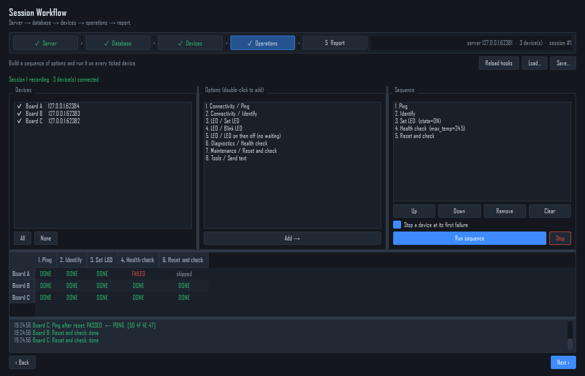
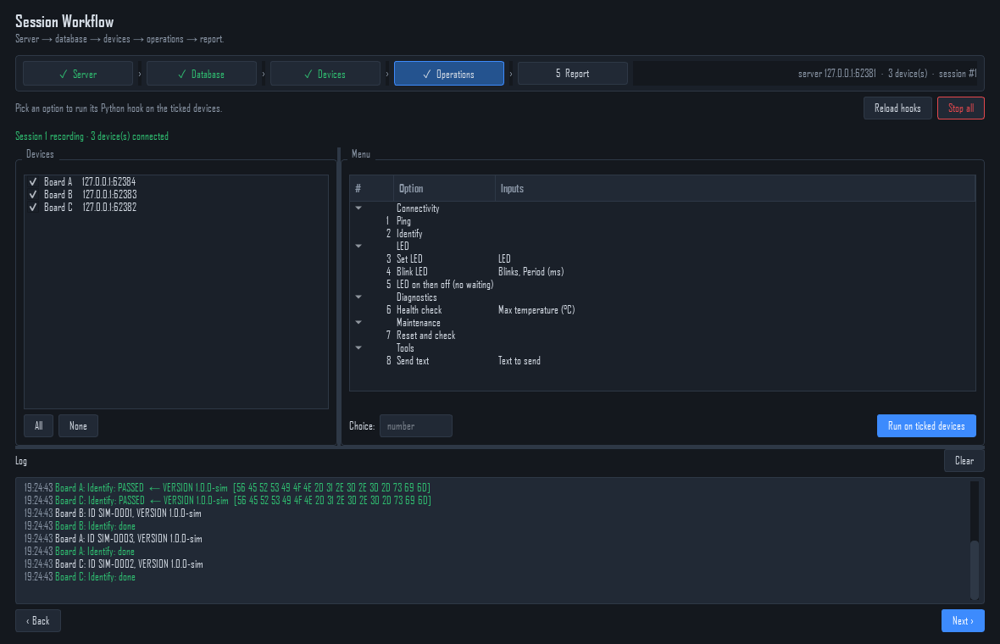
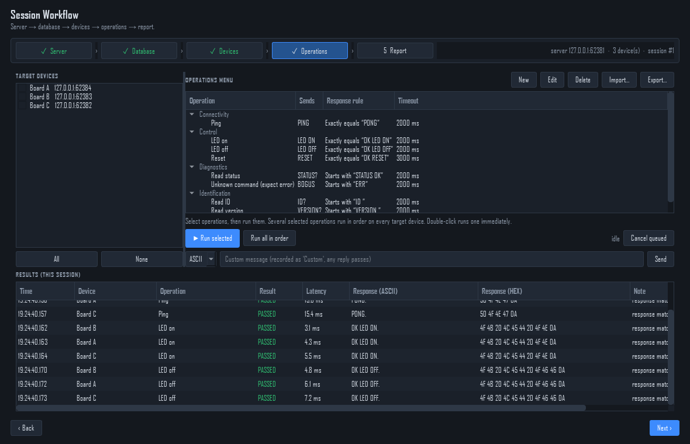

# Pick a layout for the operations menu

Your menu hooks (see [Menu hooks](menu-hooks.md)) can be shown in several
layouts. Each one runs the same `@menu_option` functions on the same devices
and stores the same results; only the way you pick and run options differs.

Every screenshot below is step 4 of the Session Workflow with three simulated
devices (Board A, B, C) and the example hooks from `plugins/example_menu.py`.

## Put a layout in the workflow

One command creates the page from a template and makes it step 4:

```bash
python tools/new_page.py ops "Operations" --template menu_buttons --workflow
```

This writes `plugins/ops.py` (yours to edit) and sets in `project.json`:

```json
"workflow_operations": "plugins.ops:OpsPage"
```

Restart the program. To use a layout as a tab of its own instead, leave out
`--workflow`. To go back to the built-in step, set `workflow_operations` to
`"operations"` (fixed operations) or `"menu"` (the Operations Menu page).

Every layout works with step 3: **Operations for selected…** ticks those
devices, and right-clicking a device → **Run operation** lists your options.

## The layouts

### `menu_console`: C-style console

Numbered text menu and an `Enter choice:` prompt, like the C test program it
replaces. Options with inputs ask for each value in turn (`Blinks [3]:`);
Enter keeps the value in brackets. `m` menu, `r` reload, `s` stop, `c` clear.

**Pick it when** your team knows the C console and wants the same keyboard
flow.



```bash
python tools/new_page.py ops "Operations" --template menu_console --workflow
```

### `menu_buttons`: one button per option

Large buttons grouped by category. Options with inputs show `…` and ask in a
dialog. After a run, the border shows the result: green when every device
passed, red when any failed.

**Pick it when** operators run a few options often, or on a touch screen.



```bash
python tools/new_page.py ops "Operations" --template menu_buttons --workflow
```

### `menu_form`: inputs on the page

Pick an option in the list; its description and inputs appear on the right,
no pop-up. Each device's outcome is added to a results table.

**Pick it when** options have several inputs you adjust between runs.



```bash
python tools/new_page.py ops "Operations" --template menu_form --workflow
```

### `menu_sequence`: test procedure

Double-click options to build an ordered sequence, each step with its own
inputs. **Run sequence** runs it on every ticked device (devices in parallel)
and fills a grid: one row per device, one column per step. With **Stop a
device at its first failure**, the rest of that device's steps are `skipped`.
**Save… / Load…** keep a sequence as JSON.

**Pick it when** you run the same procedure on every board, such as
production or acceptance tests.



```bash
python tools/new_page.py ops "Operations" --template menu_sequence --workflow
```

### Built in, for comparison

`"workflow_operations": "menu"`: the Operations Menu page (tree menu, number
box, log). No file is generated, so there is nothing to edit.



`"workflow_operations": "operations"` (the default): fixed operations from
command sets, no Python.



## Changing a layout

The generated file is ordinary Qt code, and the parts it shares with the
other layouts come from `app/ui/widgets/hook_widgets.py`:

| Building block | What it is |
|---|---|
| `DeviceTargets` | the tickable device list (`ticked()`, `set_targets()`) |
| `WorkflowStatus` | the "Session N recording" line |
| `ParamForm` / `ParamDialog` | inputs for an option's `Param`s |
| `HookLog` | the coloured log |
| `HookLauncher` | runs an option on devices (`start()`), `stop_all()`, remembers last inputs |
| `load_options()` | the hook options in menu order |

A page used as step 4 receives `embedded=True` (hide its title, drop margins)
and should keep `options`, `set_targets()` and `run_option()` so step 3's
right-click menu works. All four templates do.

Edit `plugins/ops.py` and restart. To start over from a template, delete the
file and run `new_page.py` again.
