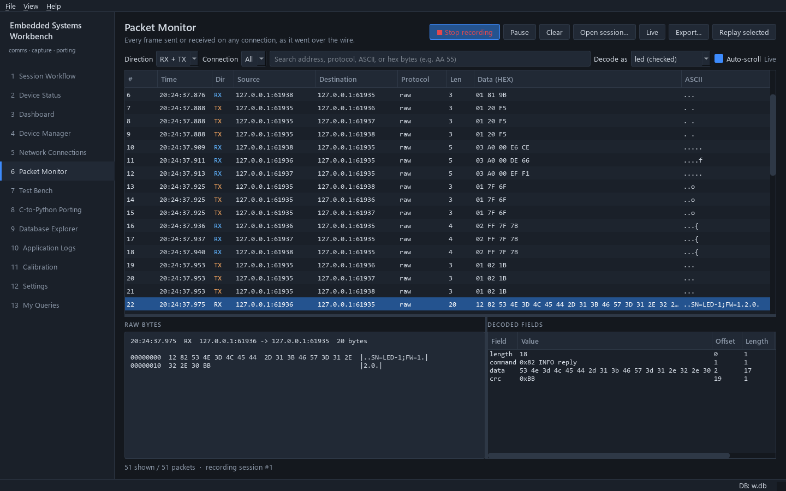

# Guide: decode your device's frames

A decoder turns a frame into named fields. The **Packet Monitor** shows them
under the hex dump of the selected frame, with failed checks in red. The
application ships no decoders; you add one per protocol.

There are two kinds:

| Kind | Write it as | Pick it when |
|---|---|---|
| Declarative | A JSON-style layout of fields | The frame is a flat sequence of fixed fields |
| Code | A Python class | You need logic: CRC checks, variable layouts, TLVs, nested messages |

Both are registered from a plugin's start-up hook, so they live with your
project's code.



*An INFO reply decoded by the code decoder from [section 2](#2-code-decoder), chosen in **Decode as**.*

---

## 1. Declarative decoder

Describe the fields in order. This one reads the frames of the
[LED example](../../examples/led_device/README.md) (`LEN | CMD | DATA | CRC8`):

```python
# plugins/led_protocol.py
"""Decoders for the LED device protocol."""

from app.core.protocols.declarative import DeclarativeDecoder

LED_FRAME = {
    "byte_order": "big",
    "fields": [
        {"name": "length", "type": "uint8_t"},
        {"name": "command", "type": "uint8_t", "format": "hex",
         "enum": {"1": "PING", "2": "INFO", "16": "LED", "17": "BLINK", "32": "TEMP", "48": "RESET",
                  "129": "PING reply", "130": "INFO reply", "144": "LED reply", "145": "BLINK reply",
                  "160": "TEMP reply", "255": "ERROR"}},
        {"name": "data_and_crc", "type": "bytes"},
    ],
}


def register(registry) -> None:
    """Register the LED decoders once the services exist.

    Args:
        registry: Page registry; only its start-up hook is used.
    """
    registry.on_startup(lambda ctx: ctx.protocols.register(DeclarativeDecoder("led", LED_FRAME)))
```

Add `"plugins.led_protocol"` to `plugins` in `project.json` (a plugin does
not have to add a page). Restart the app.

Field options:

| Key | Meaning |
|---|---|
| `name` | Field name shown in the monitor (unique) |
| `type` | `uint8_t` … `uint64_t`, `int8_t` … `int64_t`, `float`, `double`, `bytes`, `ascii` |
| `byte_order` | `big` or `little`, overrides the definition's default |
| `length` | Size of a `bytes` or `ascii` field |
| `length_from` | Take the size from an earlier integer field |
| *(no length)* | A `bytes`/`ascii` field without a length takes the rest of the frame; it must be last |
| `expect` | Required value; a mismatch is shown in red |
| `enum` | Names for values: `{"1": "READ", "2": "WRITE"}` |
| `format` | `"hex"` to show an integer in hex |
| `bits` | Sub-fields of an integer: `[{"name": "ack", "shift": 0, "width": 1}]` |

An invalid definition raises `DefinitionError` with the reason. The app
still starts without that decoder, and the error is in **Application Logs**
as "plugin start-up hook failed". The full format is documented at the top of
`app/core/protocols/declarative.py`.

## 2. Code decoder

Subclass `ProtocolDecoder` and return a `DecodedMessage`. `decode()` must
never raise for bad input: report problems in `errors` or mark a field
`valid=False`. This version also checks the CRC:

```python
from app.core.compatibility.crc import CRC8, Crc
from app.core.protocols.decoder import DecodedField, DecodedMessage, ProtocolDecoder

COMMANDS = {0x01: "PING", 0x02: "INFO", 0x10: "LED", 0x11: "BLINK", 0x20: "TEMP", 0x30: "RESET"}
_crc = Crc(CRC8)


class LedDecoder(ProtocolDecoder):
    name = "led (checked)"

    def decode(self, frame: bytes) -> DecodedMessage:
        """Split a LEN | CMD | DATA | CRC8 frame and verify its length and CRC.

        Args:
            frame: One complete frame.

        Returns:
            The fields, with a failed length or CRC check marked invalid.
        """
        message = DecodedMessage(self.name)
        if len(frame) < 3:
            message.errors.append(f"frame too short: {len(frame)} bytes")
            return message
        length, cmd, data, crc = frame[0], frame[1], frame[2:-1], frame[-1]
        reply = bool(cmd & 0x80) and cmd != 0xFF
        name = "ERROR" if cmd == 0xFF else COMMANDS.get(cmd & 0x7F, "unknown") + (" reply" if reply else "")
        expected_crc = _crc.compute(frame[:-1])
        message.fields += [
            DecodedField("length", length, 0, 1, valid=length == len(frame) - 2,
                         note="" if length == len(frame) - 2 else f"frame has {len(frame) - 2}"),
            DecodedField("command", cmd, 1, 1, display=f"0x{cmd:02X} {name}"),
            DecodedField("data", data, 2, len(data), display=data.hex(" ") or "(none)"),
            DecodedField("crc", crc, len(frame) - 1, 1, display=f"0x{crc:02X}", valid=crc == expected_crc,
                         note="" if crc == expected_crc else f"expected 0x{expected_crc:02X}"),
        ]
        message.summary = name
        return message
```

Register it the same way: `ctx.protocols.register(LedDecoder())` in an
`on_startup` hook. Test it without Qt:

```python
def test_led_decoder_flags_a_bad_crc():
    good = LedDecoder().decode(bytes.fromhex("01 01 12"))
    bad = LedDecoder().decode(bytes.fromhex("01 01 00"))
    assert good.valid and not bad.valid
```

When you port a C protocol module, put its decoder next to the ported code
and register it the same way; see [PORTING_GUIDE.md](../PORTING_GUIDE.md).

## 3. Use it

* **Packet Monitor:** select a frame and pick the decoder in **Decode as**, or leave it on the connection's own decoder.
* **Network Connections:** set **Protocol decoder** on a connection so its
  frames use that decoder by default.
* **Device Manager:** set **Protocol** on a device.
* **From code:** `ctx.protocols.decode(packet, "led")` returns the
  `DecodedMessage` (or None if no decoder has that name).

A decoder sees exactly one frame, as cut by the connection's framing. If the
fields look shifted, check the framing first
([device operations guide](device-operations.md#1-choose-the-framing)).

## Stored definitions

`ctx.protocols.save_definition(name, "declarative", definition)` stores a
definition in the `protocols` table of the current application database and
registers it. Stored definitions are loaded again at start-up and when the
Session Workflow opens another database, but only from the database they
were saved in. Registering from code, as above, is simpler for decoders that
belong to your project: they are available whatever database is open.
